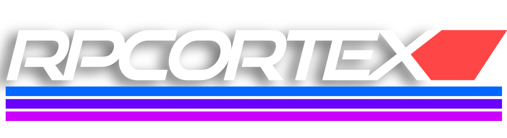

<p align="center">
  <a href="https://github.com/dash1101/RPCortex"></a>
</p>

<p align="center">
  <a href="https://github.com/dash1101/RPCortex/releases"></a>
  <a href="https://github.com/dash1101/RPCortex/blob/main/LICENSE"></a>
  <a href="https://rpc.novalabs.app"></a>
  <a href="https://discord.gg/hcEWwSNDBa"></a>
</p>

# RPCortex Vela II

RPCortex is an operating system for the Raspberry Pi Pico boards, written in C++
and running straight on the chip. It puts a real shell, user accounts and a
filesystem on a microcontroller that costs a few dollars, and it loads packages
while it runs. On the wireless boards it joins Wi-Fi, speaks HTTPS and Bluetooth,
and updates itself over the air. When a boot keeps failing, it works through a
recovery ladder on its own. On the RP2350 boards packages run in a sandbox, so a
package that crashes takes down its own command and nothing else.

Vela II is the second generation. It replaces
[RPCortex v1](https://github.com/dash1101/RPCortex-OS), which ran on MicroPython.
The shell and commands will feel familiar, and `.rps` scripts carry over
unchanged. It's in beta and still changing from one release to the next.

## Highlights

- **A shell that behaves like one.** Pipes, `&&`, `;`, redirection, history, Tab
  completion, and Ctrl+C that stops whatever is running.
- **Accounts.** Salted SHA-256 passwords, admin and guest roles, system files
  that ordinary accounts can't read or change, and `sudo` for anything that
  changes the system: packages, accounts, firmware, what starts at boot. See
  [PERMISSIONS.md](PERMISSIONS.md).
- **Packages at run time.** `pkg install` fetches one from the package repository
  and its commands are live straight away. On the RP2350 each package runs
  unprivileged behind the memory protection unit, and a big one can run from
  flash to save RAM.
- **Both cores.** Background jobs, supervised services, a scheduler, `ps` and
  `kill`. A runaway task gets preempted after 250 ms.
- **Networking on the W boards.** Wi-Fi, HTTPS with verified certificates, `curl`,
  NTP, and Bluetooth LE and Classic (it can play a WAV to a Bluetooth speaker).
- **SSH on the Pico 2 W.** `ssh server on`, then `ssh root@<device>` from a
  computer on the same network; `ssh` on the device reaches other machines. Off
  until it's turned on. [SSH.md](SSH.md) has the details.
- **Files.** littlefs on the onboard flash, and a USB drive mode (`download`) for
  moving files by drag and drop.
- **Updates and recovery.** `update` installs new firmware over the air and can
  roll it back. After three failed boots the device tries the cheapest fix first
  (start without packages or services), then the previous firmware, then a
  filesystem rebuild.

## Boards and requirements

| Board | Chip | RAM | Heap | Flash | Filesystem | Radio |
|---|---|---|---|---|---|---|
| **Pico 2 W** | RP2350 | 520 KB | 323 KB | 4 MB | 1792 KB | Wi-Fi, Bluetooth |
| Pico 2 | RP2350 | 520 KB | 416 KB | 4 MB | 2816 KB | none |
| Pico W | RP2040 | 264 KB | 75 KB | 2 MB | 384 KB | Wi-Fi, Bluetooth |
| Pico | RP2040 | 264 KB | 168 KB | 2 MB | 1280 KB | none |

Heap is the RAM left once the firmware's own data is in place, taken from the
build. Task stacks, packages and HTTPS sessions all come out of it.

**Minimum:** an RP2040 (dual Arm Cortex-M0+, ARMv6-M) with 264 KB of RAM and 2 MB
of flash, which means a Pico or a Pico W.

**Recommended:** a Pico 2 W. RP2350 (dual Arm Cortex-M33, ARMv8-M), 520 KB of RAM,
4 MB of flash and the radio. It's the main target, and every hardware result so
far comes from one.

The other three images build and pass the image checks, but none of them has run
on real hardware yet (the Pico image does boot in the emulator). The RP2040
boards also give up a few things:

- No package sandbox. Packages run with the OS's own privileges, so a bad pointer
  in one can crash the whole device.
- No flash slot, so packages are copied whole into RAM and the biggest ones may
  not fit.
- No microSD.
- Much less heap, especially on the Pico W, where the radio stack leaves about
  75 KB. HTTPS alone needs about 45 KB.

There's no ESP32-S3 port yet. v1 still runs there.

## Getting started

1. Download the `.uf2` for the board from the
   [releases page](https://github.com/dash1101/RPCortex/releases).
2. Hold BOOTSEL while plugging the board in. It shows up as a USB drive; copy the
   `.uf2` onto it and the board restarts into RPCortex.
3. Open the board's serial port in any terminal at 115200.
4. First-run setup asks five things: a root password, the owner, a device name,
   Wi-Fi (on the W boards) and the time zone. Then:

```
root@vela:/>
```

`help` lists what's there. On the W boards, `update check` and `update install`
keep it current from then on.

## Tools for the computer

- [`tools/rpc`](tools/rpc/README.md) is a command-line tool for Linux, macOS and
  Windows.
- [`tools/web`](tools/web/README.md) does the same from a browser, over Web Serial.

Both run commands, move files in either direction, install packages from the
repository (even on a board with no network) and flash firmware. They talk to
the board over its USB serial port using the protocol in [LINK.md](LINK.md).

## Building from source

On Linux, with CMake, the Arm GNU toolchain (`arm-none-eabi-gcc`), Python 3 and
g++:

```
git clone --depth 1 --branch 2.3.0 --recurse-submodules --shallow-submodules https://github.com/raspberrypi/pico-sdk.git sdk
git clone --depth 1 --branch v2.11.1 https://github.com/littlefs-project/littlefs.git littlefs
./build.sh            # all four boards, into out/
./build.sh pico2_w    # just one
```

The host test suites run at the end of every build, and an image that has
outgrown its board's firmware slot fails the build. littlefs is pinned to v2.11 so
the on-disk format stays the one v1 uses. `emu/` boots the Pico image under Renode
with no board attached.

## Writing packages

A package is a small C++ program, built on a PC and installed with `pkg`. It adds
shell commands and can run tasks, draw on the terminal and reach the hardware
through the OS. [PACKAGES.md](PACKAGES.md) covers all of it, starting from the
smallest working example.

## Documentation

- [PACKAGES.md](PACKAGES.md): writing a package, the ABI, the sandbox, size limits
- [LINK.md](LINK.md): the protocol the computer-side tools speak
- [SSH.md](SSH.md): logging in over the network, keys, and what SSH supports
- [TESTING.md](TESTING.md): what the host suites prove, and what needs a board
- [ARCHITECTURE.md](ARCHITECTURE.md): why the scheduler, sandbox and networking are built the way they are
- [RELEASING.md](RELEASING.md): version numbers and how a release is cut
- [AGENTS.md](AGENTS.md): the rules for anyone changing the code
- [CHANGELOG.md](CHANGELOG.md): what changed in each release, and the known limitations
- [emu/README.md](emu/README.md): the emulator, and what it can't model

## License

The RPCortex License. The source is public to read and learn from; anything else
needs written permission. See [LICENSE](LICENSE).

Built by [dash1101](https://github.com/dash1101) ·
[rpc.novalabs.app](https://rpc.novalabs.app) ·
[Discord](https://discord.gg/hcEWwSNDBa)

<sub>An LLM was used to assist development and cut down on time. The design and the
decisions are dash1101's, and changes are tested on real hardware before they ship.</sub>
